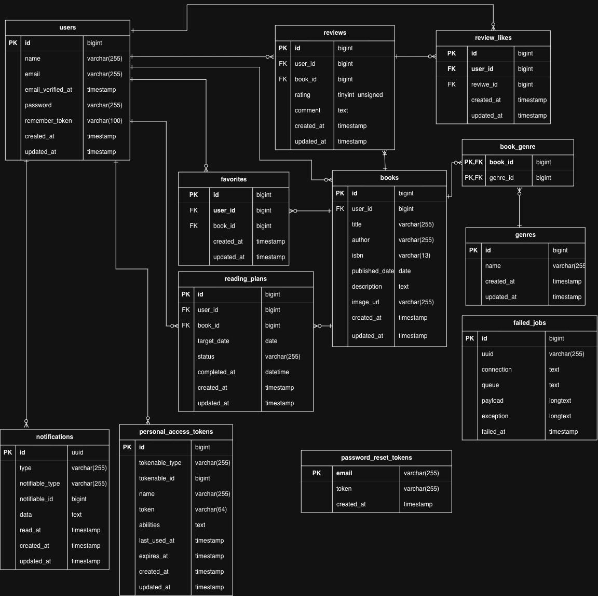

# BookShelf 書籍レビューアプリ

## 概要

BookShelfは、書籍の登録・検索・閲覧、レビュー投稿、お気に入り登録などができる書籍レビューアプリです。ブラウザ向けのWeb画面（Laravel Blade）に加え、外部アプリケーション向けのJSON APIを提供します。

### 主な機能

- ユーザー登録・ログイン・ログアウト
- 書籍の登録・一覧・詳細・編集・削除
- 書籍のキーワード検索、ジャンル絞り込み、並び替え、ページネーション
- ジャンル管理
- レビューの投稿・編集・削除、レビューへのいいね
- お気に入り登録・解除
- 平均評価に基づく書籍ランキング
- ISBNからの書籍情報検索（Google Books API）
- 読書計画の登録・管理、日次バッチによるステータスの自動更新・リマインダー通知
- マイ読書レポート
- 書籍API（一覧・詳細の取得、認証付きの登録・更新・削除）

## 使用技術

| 項目 | 技術 |
| --- | --- |
| バックエンド | PHP 8.5 / Laravel 10 |
| データベース | MySQL 8.4 |
| フロントエンド | Blade / Vite / Tailwind CSS 3 / Alpine.js |
| 認証 | Laravel Fortify（Web） / Laravel Sanctum（API） |
| 開発環境 | Docker / Docker Compose / Laravel Sail / phpMyAdmin |
| テスト・コード整形 | PHPUnit / Laravel Pint |
| 外部API | Google Books API |

## 環境構築

### 事前準備

Docker Desktop、Gitを利用できる環境を用意してください。

以下は、このリポジトリを取得した後の環境構築手順です。プロジェクトの初期作成は、要件Excel「シート4 環境構築手順」のLaravel 10指定手順に従っています。

### 1. プロジェクトを取得

以下のコマンドでGitHubからリポジトリをクローンします。

```bash
git clone https://github.com/emi-26/bookshelf-app.git
cd bookshelf-app
```

### 2. PHPの依存パッケージをインストール

```bash
docker run --rm -u "$(id -u):$(id -g)" -v "$(pwd):/var/www/html" -w /var/www/html -e COMPOSER_CACHE_DIR=/tmp/composer_cache laravelsail/php82-composer:latest composer install
```

### 3. `.env` を作成・設定

```bash
cp .env.example .env
```

`.env` のデータベース設定を次のとおりにしてください。

```dotenv
APP_URL=http://localhost
DB_CONNECTION=mysql
DB_HOST=mysql
DB_PORT=3306
DB_DATABASE=laravel
DB_USERNAME=sail
DB_PASSWORD=password
```

`DB_HOST` には `localhost` ではなく、Docker Composeのサービス名 `mysql` を指定します。

### 4. コンテナを起動

```bash
./vendor/bin/sail up -d
```

Apple Silicon環境向けのMySQL設定（`platform: linux/amd64`）とphpMyAdminサービスは、`compose.yaml` に設定済みです。

### 5. アプリケーションキーを生成

```bash
./vendor/bin/sail artisan key:generate
```

### 6. データベースを作成して初期データを投入

```bash
./vendor/bin/sail artisan migrate --seed
```

既存データをすべて削除して再構築するときのみ、次のコマンドを使用してください。

```bash
./vendor/bin/sail artisan migrate:fresh --seed
```

### 7. フロントエンドの依存パッケージをインストール

```bash
./vendor/bin/sail npm install
```

### 8. Vite開発サーバーを起動

別のターミナルで次を実行し、開発中は起動したままにしてください。

```bash
./vendor/bin/sail npm run dev
```

### 9. ブラウザで確認

- Webアプリ：http://localhost
- phpMyAdmin：http://localhost:8080

初期データには、動作確認用のユーザーと書籍等が登録されます。例：`yamada@example.com` / `password`（ローカル開発環境用）。

## 読書計画のバッチ処理

進行中および期限切れの読書計画を対象に、目標日に応じたステータスの自動更新およびユーザーへのリマインダー通知を行う日次バッチを実装しています。

### 処理内容

- 目標日の3日前：進行中の計画にリマインダー通知
- 目標日当日：進行中の計画にリマインダー通知
- 目標日の翌日以降：進行中の計画のステータスを期限切れに変更
- 目標日の3日後：期限切れの計画に期限超過通知

完了済みの読書計画はバッチ処理の対象外です。

同じ読書計画・同じ通知タイミングに対する通知の重複作成を防止しています。

### 手動実行（動作確認用）

バッチ処理の動作を確認する場合は、以下のコマンドを実行してください。

```bash
./vendor/bin/sail artisan reading-plans:process
```

コマンドを実行すると、目標日に応じて読書計画のステータスが自動更新され、通知条件を満たす読書計画についてユーザーに通知が送られます。

実行後、読書計画一覧画面および通知一覧画面で処理結果を確認できます。

### 定期実行

Laravelのスケジューラーにより、毎日午前0時（アプリケーションのタイムゾーン基準）にバッチ処理を実行する設定にしています。

ローカル環境で定期実行を行う場合は、別のターミナルで以下のコマンドを実行し、起動したままにしてください。

```bash
./vendor/bin/sail artisan schedule:work
```

## APIエンドポイント一覧

ベースURL：`http://localhost/api/v1`

| メソッド | エンドポイント | 概要 | 認証 |
| --- | --- | --- | --- |
| GET | `/books` | 書籍一覧を取得（デフォルト20件/ページ） | 不要 |
| GET | `/books/{book}` | 書籍詳細を取得 | 不要 |
| POST | `/books` | 書籍を登録 | Sanctumが必要 |
| PUT | `/books/{book}` | 書籍を更新 | Sanctumが必要・所有者のみ |
| DELETE | `/books/{book}` | 書籍を削除 | Sanctumが必要・所有者のみ |

一覧APIは `keyword`、`genre_id`、`page`、`per_page` などのクエリパラメータに対応します。存在しない書籍へのアクセスは404、未認証の書き込みは401、権限のない更新・削除は403を返します。

## URL

- アプリ：http://localhost
- ログイン：http://localhost/login
- 会員登録：http://localhost/register
- 書籍一覧：http://localhost/books
- phpMyAdmin：http://localhost:8080

## ER図



## テスト・コード整形

```bash
./vendor/bin/sail artisan test
./vendor/bin/sail pint --test
```

## 作成者

二村 絵美
